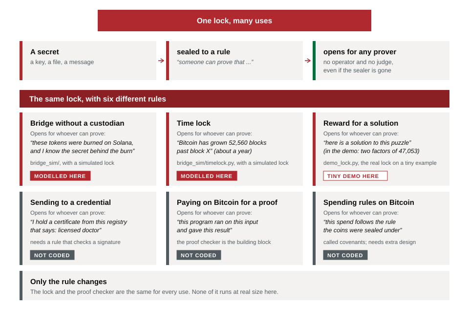
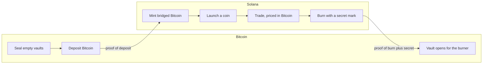

# Bitcoin Witness Bridge Simulator

[](https://github.com/CyberaCapital/bitcoin-witness-bridge-simulator/actions/workflows/tests.yml)
[](LICENSE)

<p align="center">
  
</p>

> **Simulator only. This is not a bridge.** It touches no real network and no real
> money. The bridge model uses a simulated lock, and the real lock included here runs
> only at toy parameters with no security. Everything is a first draft written with
> an AI assistant and has not been reviewed by cryptographers. Do not put funds
> behind anything derived from it without independent audits.

Three things in one repository, all meant to be read, run and attacked:

- **`bridge_sim/`** A runnable model of a trust-minimised Bitcoin to Solana bridge
  built on witness encryption, with coin launches priced in the bridged Bitcoin.
- **`praxis_lock/`** A reference implementation of the witness-encryption scheme
  itself, at toy parameters, with real BN254 pairings.
- **`praxis_lock/encoding/`** An encoding of a Groth16 proof checker in the form
  the lock understands, so that "holds a valid proof" becomes something a key can
  be locked to. It works on real proofs. It is about 1.4 times larger than the
  encoding the paper reports, and it has known gaps.

The idea comes from *Praxis: Practical Witness Encryption for NP* (Tse, Vanjani,
Vesely, [ePrint 2026/2971](https://eprint.iacr.org/2026/2971)): lock a Bitcoin key so
that it opens only for someone holding a valid proof, with no operator in between.
This project is independent. It is not affiliated with the paper's authors, Babylon,
Bitcoin or Solana, and the bridge design here is not taken from the paper.

The bridge is one use of such a lock. [One lock, many uses](#one-lock-many-uses)
shows others, says which are coded here (few) and lists the limits they share.

## Try it in one minute

Python 3.11 or newer. Nothing to install, except `py_ecc` if you want real pairings.

```
git clone https://github.com/CyberaCapital/bitcoin-witness-bridge-simulator
cd bitcoin-witness-bridge-simulator
python demo.py                 # the bridge: deposit, launch a coin, trade, redeem; then a time lock
python demo_lock.py --fast     # the lock, on a backend that hides nothing
pip install py_ecc
python demo_lock.py            # the lock with real BN254 pairings (about 25 s)
python demo_encoding.py        # a real Groth16 proof against its checker written as lock gates (about 45 s)
python -m unittest -v          # 110 tests, about 6 minutes with py_ecc, 1 minute without
```

## Try to break it

The most useful thing you can do is find an attack that works. Write it as a test
(see `tests/test_bridge.py` for helpers that forge signatures and mine private
forks) and open an issue. [CONTRIBUTING.md](CONTRIBUTING.md) explains what counts.

## One lock, many uses

The lock knows nothing about Bitcoin or Solana. It opens for whoever can prove that
a rule was met, and the rule can be any program that looks at evidence and answers
yes or no. The paper names these uses of witness encryption: public-key,
identity-based and attribute-based encryption, time-lock encryption that opens once
a blockchain reaches a given length, one-time programs, and on Bitcoin bridges
without a custodian, proof verification and covenants.

<p align="center">
  
</p>

What this repository has of each:

| Use | The lock opens for whoever can prove | Here |
|---|---|---|
| Bridge without a custodian | these tokens were burned on Solana, and I know the secret behind the burn | **Modelled** end to end in `bridge_sim/`, with a simulated lock |
| Coin launches priced in bridged Bitcoin | uses the bridge; no lock of its own | **Modelled** in `bridge_sim/launchpad.py` |
| Time lock | Bitcoin has grown N blocks past block X | **Modelled** in `bridge_sim/timelock.py`, with the same simulated lock. It counts blocks on the model's small chain at one fixed difficulty, and blocks mined in secret open it early; a test shows that |
| Reward for a solution | here is a solution to this puzzle | **Toy demo.** `demo_lock.py` seals a message to "two numbers whose product is 47,053" with the real lock at toy size; `demo_encoding.py` checks a real Groth16 proof of the same claim with the lock's gates |
| Sending to a credential | I hold a certificate, signed by this key, that says so-and-so | **Not coded** |
| Paying on Bitcoin when a proof exists | this program ran on this input and gave this result | **Not coded.** The proof checker in `praxis_lock/encoding/` is the piece it would rest on |
| Spending rules on Bitcoin (covenants) | this spend follows the rule the coins were sealed under | **Not coded** |
| One-time programs | a program that can be run on one input only | **Not coded** |
| Bridges to other chains | these tokens were burned on that chain | **Not coded.** Each chain needs its own proof that a burn is final |

One lock can serve them all because, in the paper's design, every rule is run inside
a zero-knowledge machine and its proof is wrapped into one small Groth16 proof. The
lock is then always sealed to the same kind of statement, "a valid proof exists for
this program", which is what `praxis_lock/encoding/` writes out. A new use needs a
new rule and nothing else. Of the five stages below, this repository has two rules
(the bridge's and a small time lock, both plain Python handed to the simulated
lock), a toy Groth16 system, the proof checker with known gaps, and the lock at toy
size. The zero-knowledge machine is not here at all, and nothing is joined up from
end to end.

<p align="center">
  
</p>

Three of the uses that are not the bridge, step by step:

<p align="center">
  
</p>

Limits that every use shares:

<p align="center">
  
</p>

- **The rule is fixed when the lock is made.** It sees nothing afterwards except
  what a proof shows it. Anything current, such as which block is the latest or
  which validators are in charge, has to be proven from evidence, and the rule has
  to say in advance what counts as evidence. A sealed rule cannot be changed or
  withdrawn.
- **Whoever holds a proof can open.** The lock does not know who anyone is. If the
  evidence is public, like block headers, the secret is public once the rule is
  met. That suits a time lock. A payment needs a rule that also asks for a secret
  only the intended party knows, as the bridge does with the burner's secret.
- **Opening is once and for all.** There is no partial opening and no taking it
  back.
- **Evidence can be forged at a price.** A time lock on Bitcoin's length is as
  strong as the cost of mining those blocks in private. A rule that trusts
  signatures is as strong as those keys. [What the known limit
  means](#what-the-known-limit-means) works this out for the bridge.
- **Size and work.** About 8 GB of public data for each sealed key piece at the
  paper's parameters, about 11 GB with this repository's encoding, and heavy
  computing to make and to open.
- **One setup behind every lock.** Whoever ran the proof system's setup and kept
  its secret numbers can open every lock made for that key. The paper says so.
- **Not safe against quantum computers, and not reviewed.** The paper is new, and
  nothing here has any security at the sizes it runs.

## The lock itself (`praxis_lock/`)

A Python transcription of the Praxis scheme from the definitions in the authors'
machine-checked Lean development
([psivesely/praxis-lean](https://github.com/psivesely/praxis-lean)): the statement
format, the quadratic arithmetic program, the extension-field weights, encryption,
and decryption ending in a small search.

```python
from praxis_lock import (BN254Groups, Params, encrypt, decrypt, pad,
                         product_equals, number_bits)

# Statement: "two 8-bit numbers whose product is 47,053".
P = Params.toy(N=16, gates=1, U=2, n=8, d=2, K1=2, g=7)
statement = pad(P, [product_equals(range(1, 9), range(9, 17), 47053)])
G = BN254Groups()
ciphertext = encrypt(G, P, statement, b"a key piece for a Bitcoin vault.")

factors = [1] + number_bits(211, 8) + number_bits(223, 8)
decrypt(G, P, statement, ciphertext, factors)                                  # the secret
decrypt(G, P, statement, ciphertext, [1] + number_bits(211, 8) + number_bits(222, 8))  # None
```

On BN254 that ciphertext is 808 group elements, about 48 KB; locking takes about
15 seconds and opening about 10, in pure Python.

What the tests establish:

- A solution opens the ciphertext, across eight parameter sets and random
  statements, and with real pairings on BN254. Wrong answers do not.
- The identities the Lean correctness proof rests on hold numerically.
- The fast decryption formulas equal the literal sums written in the Lean text.
- The paper's own parameters pass this code's structural checks, and its element
  counts reproduce the published ciphertext size (about 7.9 GiB).

What it is not:

- **Not secure.** Toy statements have a handful of unknown bits and can be solved
  by trying every answer. Security needs the paper's parameters.
- **Not able to run at the paper's parameters.** Those need an 8 GB ciphertext and
  polynomials of degree 3.8 million; this code is quadratic-time Python.
- **Not checked against the paper's text**, only against the Lean definitions. It
  follows Lean where the two differ (the key is derived from the pair of labels of
  the key element and its negation).
- **Not connected to a proof system at a size it can run.** The paper locks to a
  Groth16 verifier, so any statement can be used through a proof. The verifier is
  written as lock gates in `praxis_lock/encoding/` (next section), but that
  statement has 560,000 bits and this Python lock handles a few thousand.
- **Not hardened.** No constant-time code, no audit, slow reference pairings.

## The proof checker as a lock statement (`praxis_lock/encoding/`)

The lock understands one kind of statement: a list of simple equations, called
gates, over unknown bits. To lock a Bitcoin key to "someone holds a valid proof",
the program that checks a proof has to be rewritten as such a list, so that the
bits of a valid proof are exactly what solves it. The paper does this for the
Groth16 proof checker and reports the size of the result (Section 6.1). It does
not describe how its encoding is built, and the authors' repository does not
contain it; their README says they plan to verify the encoding in a future update.
This directory is an independent attempt at the same job, written from first
principles. It is a different encoding and a larger one.

How it is built, from the bottom up:

- **Numbers that do not fit.** The lock's equations work modulo one 254-bit prime;
  a proof checker computes modulo a different one. So every number is written out
  in bits, and the prover supplies the quotient of each check (`emulated.py`).
  There are two layouts. The *wide* one, the default, multiplies bit by bit: each
  product in a gate is one bit of one number times a long sum over the bits of the
  other, with every constant reduced modulo the foreign prime beforehand. That
  keeps the quotient tiny, so a check costs 2 gates and about 35 bookkeeping bits.
  The *narrow* one cuts numbers into three limbs and carries between them: 5 small
  gates and about 700 bookkeeping bits per check.
- **Bigger number systems.** The pairing lives in extensions of that field with 2
  and 12 coordinates (`fields.py`).
- **The pairing.** The loop that evaluates a pairing is laid out step by step.
  Every division is replaced by a value the prover supplies and a multiplication
  that checks it. The costly last step, raising to a huge power, is replaced by a
  root the prover supplies. There are five forms (`pairing.py`). The plain one
  raises the root back to its power in 353 steps. The *folded* one checks the root
  inside the pairing loop, for about 40 extra multiplications. The *compact* one
  also stores the loop's running product in half the space, merges the two lines
  of each step before multiplying them in, and counts the loop in signed digits
  so that it has 21 additions where binary has 36. The *rescaled* one is the
  compact one with the loop's moving point followed without its y-coordinate and
  without separate values for its line. The *bundled* one, the default, keeps the
  running product in two forms so that a line needs no stored value of its own,
  and brings the second pairing's lines in a few steps at a time.
- **The checker.** A small Groth16 system for making real proofs to test with, and
  `encode_verifier`, which writes its acceptance test as gates (`groth16.py`).

```python
from praxis_lock.encoding import groth16 as g

r1cs = g.factoring_r1cs()                         # "I know two factors of a public number"
vk, trapdoor = g.setup(r1cs)
proof = g.prove(r1cs, trapdoor, [1, 47053, 211, 223, 211 * 211])

g.verify(vk, [47053], proof)                      # True: the ordinary checker
g.encode_verifier(vk, [47053], proof).satisfied   # True: the same test as lock gates
g.encode_verifier(vk, [47054], proof).satisfied   # False
g.encode_verifier(vk, [47053], proof, style="narrow", check="root")  # the first, largest form
```

Measured size on a real proof, for one verifying key and one public input, which
are fixed into the gates as constants, as they are in the paper's encoding:

| Arithmetic | Final check | Unknown bits | Gates | Most products in a gate | Times the paper |
|---|---|---|---|---|---|
| narrow | separate root | 8,513,569 | 51,632 | 69 | 21.7 |
| wide | separate root | 2,512,718 | 17,352 | 3,048 | 6.4 |
| wide | folded into the loop | 1,432,893 | 9,937 | 3,048 | 3.7 |
| wide | compact | 722,850 | 4,972 | 3,048 | 1.8 |
| wide | rescaled | 629,161 | 4,310 | 3,048 | 1.6 |
| **wide** | **bundled** | **555,753** | **3,814** | **3,048** | **1.4** |
| The paper's encoding | | 391,693 | 1,692 | at most 2,047 | 1 |

The last row but one is the default. In it, an eighth of the bits are bookkeeping
and the rest are 1,910 numbers of the proof checker's field, about 22 for each
step of the pairing loop. The narrow layout runs every check too, at 3 to 5
million bits. The bit counts of the earlier forms move by a few hundred from one
verifying key to another; the demo makes a fresh key each run.

What the tests establish:

- Both layouts of multiplication modulo a foreign prime are exactly right on
  every possible assignment of miniature instances: every true product is
  accepted and no false one is.
- At full size, no single bit of an honest multiplication can be flipped without
  a gate noticing, in either layout.
- Field and pairing values computed by the gates equal those of the `py_ecc`
  library, including the full pairing loop, in both layouts.
- In a shortened pairing computation, each helper value the prover supplies was
  replaced by a wrong one in turn, with everything after it computed consistently
  from the wrong value: 64 values with the bundled check on each of two short
  loops, 56 with the rescaled check, 58 with the compact one, 48 with the folded
  one, 43 with the separate root. Each time, the gate meant to check that value
  objected. Written out in full in the narrow layout,
  none of its roughly 240,000 bits can be flipped without a gate noticing.
- The folded and compact checks rest on facts about numbers, which are checked:
  the prover finds a root exactly when the pairing product is one; factors from
  the half-size subfield vanish in the final step; classes up to such factors
  multiply by the formula the gates use; and the signed loop gives the same class
  as the library's loop.
- The folded check has three allowed right-hand sides picked by two bits; each is
  accepted when it is the true one, and setting both bits is refused even when
  the constants are arranged so that the final equation would otherwise hold.
  The compact check needs no such choice, and that is tested too.
- The rescaled check needs a square root that lies in the base field for some
  proofs and only in its extension for others; the same gates serve both.
- The bundled check's five rules for its two forms of a running product each
  give the form of the true product, accept it, and refuse another value. Its
  bundles of the second pairing's lines, put together again, give that pairing's
  own value. However the lines are bundled, a true claim passes and a false one
  fails.
- A real Groth16 proof satisfies the verifier gates in every form above. A
  second, different proof of the same statement satisfies the same gates.
- The gates depend only on the verifying key and the public input, never on the
  proof being checked.
- A proof for the wrong public input, and proofs with each of their three points
  forged, do not satisfy them.
- A small statement about BN254 numbers, written with these building blocks, locks
  and opens through `praxis_lock` end to end, in both layouts.
- Each safety check in the encoding was removed in turn, about 165 removals in
  all, to confirm some test notices.

What it is not:

- **Not the paper's encoding.** It needs about 1.4 times as many bits. Scaling the
  paper's element counts, a ciphertext for it would be about 11 GiB, not 7.9. Its
  widest gates hold 3,048 products, above the 2,047 the paper's parameters allow,
  so it needs about 16 million evaluation points where the paper has 3.9 million.
  It has 6.5 million products in all and about 2^32 non-zero coefficients, where
  the paper has about 2.3 million and about 2^30.
- **Not runnable through this lock at full size.** It can be built and checked in
  a few seconds, but not encrypted to.
- **Not proven sound, and known to be incomplete as a checker.** It does not check
  that the proof's second point lies in the right subgroup, and it does not rule
  out the special cases of point addition where a slope is undefined. A real
  encoding must close both. The tests show that the forgeries tried here fail;
  they do not show that every forgery fails. The paper states that every solution
  of its encoding decodes to a proof the checker accepts; this one cannot say that.
- **Not a proof system to use.** The Groth16 setup and prover here exist to make
  test proofs; the prover uses the setup's secret numbers.

### From 22 times the paper's size to 1.4

The first version used the narrow layout and a separate root, and came to 22 times
the paper's size. Five changes brought it to 1.4.

*Wide gates.* The paper gives its encoding's size and shape but not its method.
Its numbers show a few very wide constraints, and it says that every one of them
has at least 254 products, which is one multiplication of 254-bit numbers done
bit by bit. The wide layout here multiplies the same way. It is our reading of
those numbers, not the paper's construction. It cut the bookkeeping from three
quarters of all bits to an eighth.

*Folding the root.* The separate root check stored 354 values of the largest
field, about half of everything. Folding it into the pairing loop is the method of
Novakovic and Eagen's *On Proving Pairings*, worked out again here for these
gates.

*The compact check.* The last step of a pairing sends every number of the
half-size subfield to 1, so the loop's running product only matters up to such
factors. That class is one number of the half-size field, six base-field numbers
where the product itself takes twelve, and classes multiply by an equation of
degree two. The two lines of a loop step are merged into one such class before
they are multiplied in, and the line of the pairing whose first point is fixed
needs no stored values at all. The loop is counted in signed digits.

*The rescaled moving point.* The loop follows a point of the second curve.
Stretching that curve by a factor taken from the proof's own first point makes
the slope and intercept of each line, which the point arithmetic stores anyway,
equal to the line's values. The point's y-coordinate is never stored: each new
line must pass through the mirror image of where the last one landed. That is 6
numbers a step where there were 10.

*Two forms and bundled lines.* Until here every loop step stored three six-number
values: the running product squared, the two lines merged, and their product.
The class of a running product can be written in two ways, as a quotient or as
its inverse, and a line is already in the second form as it stands. Squaring
gives the first form, and the first form times a line gives the second, each by
one equation of degree two, so a line needs no stored value of its own. That
only works for one pairing's line at a time. The other pairing's lines are fixed
formulas in two numbers of one proof point, so the lines of a few steps in a
row multiply to a fixed combination of powers of those two numbers. 66 such
powers are stored once, and the lines then enter in 17 bundles, two stored
values each, where they used to cost one value in each of 88 steps.

### What is left, and what was tried

The default stores 1,910 numbers, about 22 for each of the loop's 86 steps:

| Used for | Numbers |
|---|---|
| Following the moving point | about 525 |
| Multiplying a line into the running product | 528 |
| Squaring the running product | 390 |
| The second pairing's lines, in bundles | 270 |
| Multiplying the prover's root in at addition steps | 126 |
| Everything else | about 70 |

The paper's bit count has room for about 1,350 such numbers if its bookkeeping
per number is like ours, about 16 a step. Read with its other figures, the paper
also gives away how its constraints are used. It has about 2.3 million products
in all (it says that rewriting them one product per constraint would take 2^29.1
unknowns) and 1,692 constraints, so about 1.25 constraints for each stored
number, where the wide layout here uses two and has 6.5 million products. An
earlier version of this text read the paper's 231 bits per constraint as "almost
no bookkeeping". That was wrong: its constraints are fuller, and its bookkeeping
per number is probably much like ours. The gap in size is in the count of
stored numbers.

In this design a doubling step takes 18 numbers: 6 for the point, 6 for the
square, 6 for the line. Even with the second pairing and the root costing
nothing it would stop near 1.1 times the paper, so if our reading of the paper's
figures is right, its encoding holds at least one idea that is not in this one.
Four candidates were put to the same test in `experiments/relations.py`. It asks
whether honest values satisfy any equation of degree two at all, since that is
all the lock's gates can express. None works in the form tried:

- *Dropping one of the three values* of a step that multiplies both lines in at
  once. This is the step the compact and rescaled checks use; the bundled check
  gets below it another way.
- *Values of four numbers.* Working up to factors from both subfields leaves four
  numbers of information per value, not six. Three such values with x * y = z
  satisfy no equation of degree two.
- *Values of four numbers inside a loop step.* Neither do such a value and its
  square, such a value with a line and their product, or the two together.
- *The moving point by its lines alone.* Two or three tangent lines in a row,
  without the x-coordinate between them, satisfy no equation of degree two.
  Storing x at every other step leaves two equations where six are needed.

Two smaller steps are known and not built. A windowed loop with fewer additions
would save about 3 percent. A layout with one main constraint per number and a
shared one for overflow, which is what we think the paper's figures point to,
would cut gates and products but not bits.

## How the bridge works



1. **Seal.** A setup group creates an empty vault on Bitcoin. Each member makes one
   piece of the vault's key, locks it under the vault's rule and deletes it.
2. **Deposit.** A user sends exactly the vault's size in Bitcoin to the vault.
3. **Mint.** The Solana program checks the deposit against Bitcoin's block headers
   and mints the same amount of tokens to the address named in the deposit.
4. **Launch.** Anyone holding bridged Bitcoin can launch a new coin. The coin goes
   into a trading pool with that Bitcoin on the other side, so its price is quoted
   directly in Bitcoin. The starting liquidity can be locked for good.
5. **Trade.** People buy the coin with bridged Bitcoin and sell it back. Bridged
   Bitcoin itself also moves on Solana like any other token.
6. **Burn.** A holder burns bridged Bitcoin and attaches the fingerprint of a secret.
   The program assigns them the oldest funded vault of that size.
7. **Open.** The burner shows proof of the burn plus the secret. The lock releases
   the key pieces and the burner moves the native Bitcoin.

The rule that must always hold: tokens in circulation equal Bitcoin sealed in vaults.
Bitcoin sitting in a trading pool is still on the bridge's books and still backed.

## Launching coins against bridged Bitcoin

`bridge_sim/launchpad.py`. Each coin has one pool. The price is the ratio of Bitcoin
to coins in the pool; a buy adds Bitcoin and removes coins, a sell does the reverse,
and 0.30% of each trade stays in the pool.

Launching coins against wrapped Bitcoin is already possible on Solana today. What
this bridge would change is the Bitcoin side: no company or signer group holds it.

The bridge does not make a coin safe. Two tests named `WARNING` show this:

- A pool launched unlocked can be emptied by its creator, taking buyers' Bitcoin.
- Even with locked liquidity, a creator who keeps a large share of the coins can
  sell them into the pool, take out more Bitcoin than they put in, and leave the
  price below where it launched.

## The rule inside every vault

`BurnStatement` in `bridge_sim/lock.py`. A vault opens only if all of these hold:

1. The burn record names this vault, and the redeemer knows the secret behind it.
2. The record is part of a Solana state root.
3. The proof starts from the validator set fixed on the day the vault was sealed.
4. Replaying Bitcoin from the sealing block, the root was written into Bitcoin while
   its validator set was still the current one. Validator hand-offs are also written
   into Bitcoin, and the first valid hand-off for an epoch wins.
5. The root's entry in Bitcoin is buried under enough blocks of real work.

Point 4 is the answer to the hardest problem. A lock is fixed at sealing time and
cannot know which validators are current. Without it, anyone holding the keys of a
retired validator set could forge a burn. With it, Bitcoin's block order decides.

## What is real and what is simulated

| Part | In this model | In a real bridge |
|---|---|---|
| Witness-encryption lock | The bridge model uses a simulated lock: an object that releases its secret only when the rule accepts. The real scheme is in `praxis_lock/`, at toy parameters, not yet wired to the bridge | A public ciphertext of about 8 GB per key piece |
| The vault rule | Real logic, in plain Python | The same logic compiled into a zero-knowledge circuit |
| Proof checker as a lock statement | Built and tested on real proofs in `praxis_lock/encoding/`, at about 0.56 million bits with known gaps; not wired to the lock or the bridge | An audited encoding at the paper's size, about 0.39 million bits |
| Bitcoin | Real proof of work, Merkle proofs and coin tracking at tiny difficulty; no fees or scripts | Bitcoin |
| Solana | Four validators signing state roots by stake | Over a thousand validators, different signatures, and a light-client proof nobody has shipped in this form |
| Setup-honesty proof | A direct check (`SealedShare.audit`) | A zero-knowledge proof about an 8 GB file; unsolved at this size |
| Signatures and hashing | Real maths, written for clarity, not hardened | Audited libraries |

## What the tests show

Attacks that must fail, and do:

- Copying a burner's public proof without the secret.
- Using a valid proof for one vault on another.
- Claiming a burn Solana never recorded.
- Minting from an unconfirmed, underpaid, mismatched or reused deposit.
- Minting twice against one vault, burning or sending tokens you do not hold.
- Feeding the bridge Bitcoin headers with no work or no ancestry.
- A setup member locking garbage (caught before anyone deposits).
- All setup members but one colluding.
- A minority of validators, or validators the attacker invented, signing a burn.
- Leaked keys of a retired validator set, three ways: ignoring the hand-off,
  backdating the forged root, or hiding the hand-off inside a real block.
- A secretly built Bitcoin fork with no real work, or not grown from the sealing block.
- Withdrawing locked liquidity, or anyone but the creator withdrawing unlocked liquidity.
- Another program spending a pool's Bitcoin, or a pool paying out more than it holds.
- Trades that would fill below the trader's stated minimum, or with funds not held.

Each safety check was also removed in turn to confirm some test notices.

Attacks that succeed on purpose, to pin down what the design trusts:

- `ASSUMPTION`: every setup member keeps their key piece.
- `ASSUMPTION`: more than two thirds of the current validators sign a lie.
- `KNOWN_LIMIT`: the keys of a retired validator supermajority, plus six Bitcoin
  blocks mined in secret that leave out the hand-off, open a vault that is still funded.

## What the known limit means

A lock cannot tell the real Bitcoin chain from one mined in private. So the Bitcoin
resting in idle vaults is only as safe as the cost of mining the waiting period.
Six blocks is about 19 BTC of forgone block rewards (6 x 3.125) plus fees, and the
attacker also needs a retired supermajority's keys. Ways to raise the bar:

- Wait for more blocks before a vault opens. Cost and delay rise together.
- Re-seal vaults regularly, so only recently retired validator sets matter.
- Keep the total value in old vaults well below the cost of the attack.

A vault that has already been redeemed is not exposed; a test confirms this.

## Trust assumptions

1. At least one setup member deletes their key piece.
2. More than two thirds of each validator set, by stake, is honest until its
   hand-off is confirmed on Bitcoin.
3. Nobody finds it worthwhile to mine the waiting period in secret.
4. The witness-encryption mathematics holds. The paper is new and unreviewed, aims
   at 100-bit security, and is not safe against quantum computers.
5. The proof system's own setup was honest. The paper locks to a Groth16 proof
   checker, and it says plainly that whoever ran that setup and kept its secret
   numbers can make accepting proofs for anything, and so open every lock made
   for that key.

## Not modelled, or still open

- Bitcoin reorganisations, fees and real scripts; Solana forks and penalties.
- A redemption proof replays every Bitcoin block since the vault was sealed. In a
  real system that needs a proof someone keeps extending block by block.
- A hand-off must reach Bitcoin promptly. If a retiring set's keys leak first,
  forged roots would be accepted.
- A burner who loses the secret loses the vault. The tokens are already gone.
- A second deposit into a funded vault mints nothing and goes to whoever redeems it.
- Vaults are fixed-size (0.1 BTC here), so only whole vaults can be redeemed. Trading
  leaves odd amounts, which stay as tokens until they add up to a vault.
- The trading pool is the simplest kind. It has no protection against bots that
  trade ahead of an order, beyond the trader's stated minimum.
- Storage: three setup members means about 23.6 GiB of locked files per vault.

## Files

```
bridge_sim/crypto.py     curve maths, signatures, hashing, Merkle trees
bridge_sim/bitcoin.py    mini Bitcoin
bridge_sim/solana.py     mini Solana, validator hand-offs
bridge_sim/lock.py       the vault rule and the simulated lock
bridge_sim/timelock.py   a second rule for the same lock: a time lock
bridge_sim/setup.py      the sealing ceremony
bridge_sim/bridge.py     the program on Solana
bridge_sim/launchpad.py  coin launches and trading pools priced in bridged Bitcoin
bridge_sim/client.py     relaying, anchoring, building a proof
bridge_sim/scenario.py   a ready-made world for tests and the demo
praxis_lock/params.py    parameters, their structural checks, the paper's values
praxis_lock/relation.py  statements as gates over Boolean unknowns
praxis_lock/qap.py       the quadratic arithmetic program and honest quotients
praxis_lock/kummer.py    forms from a seed, extension-field weights, the grid of cells
praxis_lock/groups.py    exponent backend (no secrecy) and BN254 backend
praxis_lock/scheme.py    encrypt and decrypt
praxis_lock/reference.py the decryption sums exactly as the Lean text writes them
praxis_lock/encoding/circuit.py   builder for gates over bits; counts, checks, fingerprints
praxis_lock/encoding/emulated.py  arithmetic modulo a foreign prime, in a wide and a narrow layout
praxis_lock/encoding/fields.py    the BN254 base field and its extensions of degree 2 and 12
praxis_lock/encoding/pairing.py   curve points, the pairing loop, and five forms of the final check
praxis_lock/encoding/groth16.py   a small Groth16 system and its verifier as gates
praxis_lock/encoding/tolock.py    hands a small gate system to the lock
tests/test_bridge.py     25 bridge tests
tests/test_launchpad.py  9 launch and trading tests
tests/test_timelock.py   4 time lock tests
tests/test_praxis_lock.py 22 lock tests
tests/test_encoding.py   50 encoding tests
experiments/relations.py  four shrinking ideas, tested and found not to work
demo.py, demo_lock.py, demo_encoding.py   narrated runs
docs/overview.svg, uses.svg, pipeline.svg, examples.svg, limits.svg   the pictures on this page
docs/figures.py          draws them
```

## Next stages

1. Port the Solana program and the Bitcoin side to real test networks, keeping the
   lock simulated.
2. Write the vault rule as a zero-knowledge program and prove real burns. The
   paper's route is a program for a zero-knowledge virtual machine whose proofs
   end in Groth16, so that one fixed proof checker serves every program.
3. Shrink the proof-checker encoding towards the paper's size and close its known
   gaps.
4. Rewrite the lock in a compiled language with fast polynomial arithmetic, so it
   can run at the paper's parameters.
5. Replace the bridge's simulated lock with it, run a real setup, and get
   independent audits before any real funds.

## What stops this from being a real bridge today

- The lock here runs only at toy parameters. No implementation at secure parameters
  exists, here or publicly, and the paper is unreviewed.
- The proof checker written as a lock statement is about 1.4 times larger than the
  paper's and has known gaps, and the lock here cannot encrypt to it.
- The vault rule is plain Python. A real lock needs it as a zero-knowledge circuit,
  including proofs of Solana finality and of Bitcoin's history since sealing.
- The setup-honesty proof over an 8 GB ciphertext is an unsolved engineering problem.
- Nothing here runs on Bitcoin or Solana.
- Nothing here has been audited.

## Licence and credits

MIT licence; see [LICENSE](LICENSE). The `praxis_lock/` directory is derived from
the authors' Apache-2.0 Lean development and is under the Apache License 2.0; see
`praxis_lock/NOTICE`. The scheme, its parameters and its proofs are the work of
David Tse, Nikhil Vanjani and Psi Vesely. The encoding in `praxis_lock/encoding/`
is this project's own and is not theirs; its shortcomings are ours. It uses the
[py_ecc](https://github.com/ethereum/py_ecc) library as its reference for BN254.

Designed and written with Claude, an AI assistant made by Anthropic, and published
by CyberaCapital. Corrections and attacks are welcome.
