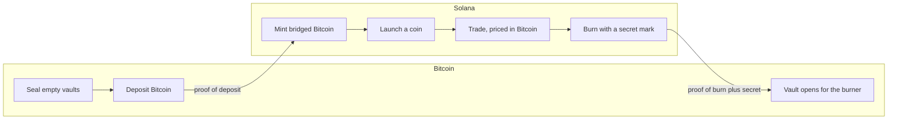

# Bitcoin Witness Bridge Simulator

[](https://github.com/CyberaCapital/bitcoin-witness-bridge-simulator/actions/workflows/tests.yml)
[](LICENSE)

> **Simulator only. This is not a bridge.** It touches no real network and no real
> money. The witness-encryption lock is simulated, because no public code for it
> exists yet. The design is a first draft written with an AI assistant and has not
> been reviewed by cryptographers. Do not put funds behind anything derived from it
> without independent audits.

A runnable model of a trust-minimised Bitcoin to Solana bridge built on witness
encryption, with coin launches priced in the bridged Bitcoin and 34 tests that
attack it. It exists so people can read the logic, run it, and try to break it.

The idea comes from *Praxis: Practical Witness Encryption for NP* (Tse, Vanjani,
Vesely, [ePrint 2026/2971](https://eprint.iacr.org/2026/2971)): lock a Bitcoin key so
that it opens only for someone holding a valid proof, with no operator in between.
This project is independent. It is not affiliated with the paper's authors, Babylon,
Bitcoin or Solana, and the bridge design here is not taken from the paper.

## Try it in one minute

Python 3.11 or newer, nothing to install.

```
git clone https://github.com/CyberaCapital/bitcoin-witness-bridge-simulator
cd bitcoin-witness-bridge-simulator
python demo.py            # a narrated run: bridge, launch a coin, trade, redeem
python -m unittest -v     # 34 tests, about 8 seconds
```

## Try to break it

The most useful thing you can do is find an attack that works. Write it as a test
(see `tests/test_bridge.py` for helpers that forge signatures and mine private
forks) and open an issue. [CONTRIBUTING.md](CONTRIBUTING.md) explains what counts.

## How the bridge works



1. **Seal.** A setup group creates an empty vault on Bitcoin. Each member makes one
   piece of the vault's key, locks it under the vault's rule and deletes it.
2. **Deposit.** A user sends exactly the vault's size in Bitcoin to the vault.
3. **Mint.** The Solana program checks the deposit against Bitcoin's block headers
   and mints the same amount of tokens to the address named in the deposit.
4. **Launch.** Anyone holding bridged Bitcoin can launch a new coin. The coin goes
   into a trading pool with that Bitcoin on the other side, so its price is quoted
   directly in Bitcoin. The starting liquidity can be locked for good.
5. **Trade.** People buy the coin with bridged Bitcoin and sell it back. Bridged
   Bitcoin itself also moves on Solana like any other token.
6. **Burn.** A holder burns bridged Bitcoin and attaches the fingerprint of a secret.
   The program assigns them the oldest funded vault of that size.
7. **Open.** The burner shows proof of the burn plus the secret. The lock releases
   the key pieces and the burner moves the native Bitcoin.

The rule that must always hold: tokens in circulation equal Bitcoin sealed in vaults.
Bitcoin sitting in a trading pool is still on the bridge's books and still backed.

## Launching coins against bridged Bitcoin

`bridge_sim/launchpad.py`. Each coin has one pool. The price is the ratio of Bitcoin
to coins in the pool; a buy adds Bitcoin and removes coins, a sell does the reverse,
and 0.30% of each trade stays in the pool.

Launching coins against wrapped Bitcoin is already possible on Solana today. What
this bridge would change is the Bitcoin side: no company or signer group holds it.

The bridge does not make a coin safe. Two tests named `WARNING` show this:

- A pool launched unlocked can be emptied by its creator, taking buyers' Bitcoin.
- Even with locked liquidity, a creator who keeps a large share of the coins can
  sell them into the pool, take out more Bitcoin than they put in, and leave the
  price below where it launched.

## The rule inside every vault

`BurnStatement` in `bridge_sim/lock.py`. A vault opens only if all of these hold:

1. The burn record names this vault, and the redeemer knows the secret behind it.
2. The record is part of a Solana state root.
3. The proof starts from the validator set fixed on the day the vault was sealed.
4. Replaying Bitcoin from the sealing block, the root was written into Bitcoin while
   its validator set was still the current one. Validator hand-offs are also written
   into Bitcoin, and the first valid hand-off for an epoch wins.
5. The root's entry in Bitcoin is buried under enough blocks of real work.

Point 4 is the answer to the hardest problem. A lock is fixed at sealing time and
cannot know which validators are current. Without it, anyone holding the keys of a
retired validator set could forge a burn. With it, Bitcoin's block order decides.

## What is real and what is simulated

| Part | In this model | In a real bridge |
|---|---|---|
| Witness-encryption lock | Simulated: an object that releases its secret only when the rule accepts | A public ciphertext of about 8 GB per key piece |
| The vault rule | Real logic, in plain Python | The same logic compiled into a zero-knowledge circuit |
| Bitcoin | Real proof of work, Merkle proofs and coin tracking at tiny difficulty; no fees or scripts | Bitcoin |
| Solana | Four validators signing state roots by stake | Over a thousand validators, different signatures, and a light-client proof nobody has shipped in this form |
| Setup-honesty proof | A direct check (`SealedShare.audit`) | A zero-knowledge proof about an 8 GB file; unsolved at this size |
| Signatures and hashing | Real maths, written for clarity, not hardened | Audited libraries |

## What the tests show

Attacks that must fail, and do:

- Copying a burner's public proof without the secret.
- Using a valid proof for one vault on another.
- Claiming a burn Solana never recorded.
- Minting from an unconfirmed, underpaid, mismatched or reused deposit.
- Minting twice against one vault, burning or sending tokens you do not hold.
- Feeding the bridge Bitcoin headers with no work or no ancestry.
- A setup member locking garbage (caught before anyone deposits).
- All setup members but one colluding.
- A minority of validators, or validators the attacker invented, signing a burn.
- Leaked keys of a retired validator set, three ways: ignoring the hand-off,
  backdating the forged root, or hiding the hand-off inside a real block.
- A secretly built Bitcoin fork with no real work, or not grown from the sealing block.
- Withdrawing locked liquidity, or anyone but the creator withdrawing unlocked liquidity.
- Another program spending a pool's Bitcoin, or a pool paying out more than it holds.
- Trades that would fill below the trader's stated minimum, or with funds not held.

Each safety check was also removed in turn to confirm some test notices.

Attacks that succeed on purpose, to pin down what the design trusts:

- `ASSUMPTION`: every setup member keeps their key piece.
- `ASSUMPTION`: more than two thirds of the current validators sign a lie.
- `KNOWN_LIMIT`: the keys of a retired validator supermajority, plus six Bitcoin
  blocks mined in secret that leave out the hand-off, open a vault that is still funded.

## What the known limit means

A lock cannot tell the real Bitcoin chain from one mined in private. So the Bitcoin
resting in idle vaults is only as safe as the cost of mining the waiting period.
Six blocks is about 19 BTC of forgone block rewards (6 x 3.125) plus fees, and the
attacker also needs a retired supermajority's keys. Ways to raise the bar:

- Wait for more blocks before a vault opens. Cost and delay rise together.
- Re-seal vaults regularly, so only recently retired validator sets matter.
- Keep the total value in old vaults well below the cost of the attack.

A vault that has already been redeemed is not exposed; a test confirms this.

## Trust assumptions

1. At least one setup member deletes their key piece.
2. More than two thirds of each validator set, by stake, is honest until its
   hand-off is confirmed on Bitcoin.
3. Nobody finds it worthwhile to mine the waiting period in secret.
4. The witness-encryption mathematics holds. The paper is new and unreviewed, and
   it is not safe against quantum computers.

## Not modelled, or still open

- Bitcoin reorganisations, fees and real scripts; Solana forks and penalties.
- A redemption proof replays every Bitcoin block since the vault was sealed. In a
  real system that needs a proof someone keeps extending block by block.
- A hand-off must reach Bitcoin promptly. If a retiring set's keys leak first,
  forged roots would be accepted.
- A burner who loses the secret loses the vault. The tokens are already gone.
- A second deposit into a funded vault mints nothing and goes to whoever redeems it.
- Vaults are fixed-size (0.1 BTC here), so only whole vaults can be redeemed. Trading
  leaves odd amounts, which stay as tokens until they add up to a vault.
- The trading pool is the simplest kind. It has no protection against bots that
  trade ahead of an order, beyond the trader's stated minimum.
- Storage: three setup members means about 23.6 GiB of locked files per vault.

## Files

```
bridge_sim/crypto.py     curve maths, signatures, hashing, Merkle trees
bridge_sim/bitcoin.py    mini Bitcoin
bridge_sim/solana.py     mini Solana, validator hand-offs
bridge_sim/lock.py       the vault rule and the simulated lock
bridge_sim/setup.py      the sealing ceremony
bridge_sim/bridge.py     the program on Solana
bridge_sim/launchpad.py  coin launches and trading pools priced in bridged Bitcoin
bridge_sim/client.py     relaying, anchoring, building a proof
bridge_sim/scenario.py   a ready-made world for tests and the demo
tests/test_bridge.py     25 bridge tests
tests/test_launchpad.py  9 launch and trading tests
demo.py                  narrated run
```

## Next stages

1. Port the Solana program and the Bitcoin side to real test networks, keeping the
   lock simulated.
2. Write the vault rule as a zero-knowledge program and prove real burns.
3. Replace the simulated lock with the paper's scheme once code exists, run a real
   setup, and get independent audits before any real funds.

## What stops this from being a real bridge today

- No public code exists for the witness-encryption scheme, and the paper is unreviewed.
- The vault rule is plain Python. A real lock needs it as a zero-knowledge circuit,
  including proofs of Solana finality and of Bitcoin's history since sealing.
- The setup-honesty proof over an 8 GB ciphertext is an unsolved engineering problem.
- Nothing here runs on Bitcoin or Solana.
- Nothing here has been audited.

## Licence and credits

MIT licence; see [LICENSE](LICENSE). Designed and written with Claude, an AI
assistant made by Anthropic, and published by CyberaCapital. Corrections and attacks
are welcome.
