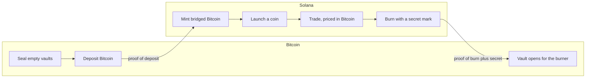

# Bitcoin Witness Bridge Simulator

[](https://github.com/CyberaCapital/bitcoin-witness-bridge-simulator/actions/workflows/tests.yml)
[](LICENSE)

> **Simulator only. This is not a bridge.** It touches no real network and no real
> money. The bridge model uses a simulated lock, and the real lock included here runs
> only at toy parameters with no security. Everything is a first draft written with
> an AI assistant and has not been reviewed by cryptographers. Do not put funds
> behind anything derived from it without independent audits.

Three things in one repository, all meant to be read, run and attacked:

- **`bridge_sim/`** A runnable model of a trust-minimised Bitcoin to Solana bridge
  built on witness encryption, with coin launches priced in the bridged Bitcoin.
- **`praxis_lock/`** A reference implementation of the witness-encryption scheme
  itself, at toy parameters, with real BN254 pairings.
- **`praxis_lock/encoding/`** A first encoding of a Groth16 proof checker in the
  form the lock understands, so that "holds a valid proof" becomes something a
  key can be locked to. It works on real proofs, and it is about 22 times larger
  than the encoding the paper reports.

The idea comes from *Praxis: Practical Witness Encryption for NP* (Tse, Vanjani,
Vesely, [ePrint 2026/2971](https://eprint.iacr.org/2026/2971)): lock a Bitcoin key so
that it opens only for someone holding a valid proof, with no operator in between.
This project is independent. It is not affiliated with the paper's authors, Babylon,
Bitcoin or Solana, and the bridge design here is not taken from the paper.

## Try it in one minute

Python 3.11 or newer. Nothing to install, except `py_ecc` if you want real pairings.

```
git clone https://github.com/CyberaCapital/bitcoin-witness-bridge-simulator
cd bitcoin-witness-bridge-simulator
python demo.py                 # the bridge: deposit, launch a coin, trade, redeem
python demo_lock.py --fast     # the lock, on a backend that hides nothing
pip install py_ecc
python demo_lock.py            # the lock with real BN254 pairings (about 25 s)
python demo_encoding.py        # a real Groth16 proof against its checker written as lock gates (about 30 s)
python -m unittest -v          # 79 tests, about 3 minutes with py_ecc, 30 s without
```

## Try to break it

The most useful thing you can do is find an attack that works. Write it as a test
(see `tests/test_bridge.py` for helpers that forge signatures and mine private
forks) and open an issue. [CONTRIBUTING.md](CONTRIBUTING.md) explains what counts.

## The lock itself (`praxis_lock/`)

A Python transcription of the Praxis scheme from the definitions in the authors'
machine-checked Lean development
([psivesely/praxis-lean](https://github.com/psivesely/praxis-lean)): the statement
format, the quadratic arithmetic program, the extension-field weights, encryption,
and decryption ending in a small search.

```python
from praxis_lock import (BN254Groups, Params, encrypt, decrypt, pad,
                         product_equals, number_bits)

# Statement: "two 8-bit numbers whose product is 47,053".
P = Params.toy(N=16, gates=1, U=2, n=8, d=2, K1=2, g=7)
statement = pad(P, [product_equals(range(1, 9), range(9, 17), 47053)])
G = BN254Groups()
ciphertext = encrypt(G, P, statement, b"a key piece for a Bitcoin vault.")

factors = [1] + number_bits(211, 8) + number_bits(223, 8)
decrypt(G, P, statement, ciphertext, factors)                                  # the secret
decrypt(G, P, statement, ciphertext, [1] + number_bits(211, 8) + number_bits(222, 8))  # None
```

On BN254 that ciphertext is 808 group elements, about 48 KB; locking takes about
15 seconds and opening about 10, in pure Python.

What the tests establish:

- A solution opens the ciphertext, across eight parameter sets and random
  statements, and with real pairings on BN254. Wrong answers do not.
- The identities the Lean correctness proof rests on hold numerically.
- The fast decryption formulas equal the literal sums written in the Lean text.
- The paper's own parameters pass this code's structural checks, and its element
  counts reproduce the published ciphertext size (about 7.9 GiB).

What it is not:

- **Not secure.** Toy statements have a handful of unknown bits and can be solved
  by trying every answer. Security needs the paper's parameters.
- **Not able to run at the paper's parameters.** Those need an 8 GB ciphertext and
  polynomials of degree 3.8 million; this code is quadratic-time Python.
- **Not checked against the paper's text**, only against the Lean definitions. It
  follows Lean where the two differ (the key is derived from the pair of labels of
  the key element and its negation).
- **Not connected to a proof system at a size it can run.** The paper locks to a
  Groth16 verifier, so any statement can be used through a proof. The verifier is
  written as lock gates in `praxis_lock/encoding/` (next section), but that
  statement has millions of bits and this Python lock handles a few thousand.
- **Not hardened.** No constant-time code, no audit, slow reference pairings.

## The proof checker as a lock statement (`praxis_lock/encoding/`)

The lock understands one kind of statement: a list of simple equations, called
gates, over unknown bits. To lock a Bitcoin key to "someone holds a valid proof",
the program that checks a proof has to be rewritten as such a list, so that the
bits of a valid proof are exactly what solves it. The paper does this for the
Groth16 proof checker and reports the size of the result (Section 6.1). It does
not describe how its encoding is built, and the authors' repository does not
contain it; their README says they plan to verify the encoding in a future update.
This directory is an independent attempt at the same job, written from first
principles. It is a different encoding and a much larger one.

How it is built, from the bottom up:

- **Numbers that do not fit.** The lock's equations work modulo one 254-bit prime;
  a proof checker computes modulo a different one. So every number is written out
  in bits, the prover supplies the quotient of each multiplication, and the gates
  check the result piece by piece with carries (`emulated.py`). One multiplication
  costs 5 gates and about 600 helper bits.
- **Bigger number systems.** The pairing lives in extensions of that field with 2
  and 12 coordinates (`fields.py`).
- **The pairing.** The loop that evaluates a pairing is laid out step by step.
  Every division is replaced by a value the prover supplies and a multiplication
  that checks it, and the costly last step is replaced by a root the prover
  supplies, raised back to its power in gates (`pairing.py`).
- **The checker.** A small Groth16 system for making real proofs to test with, and
  `encode_verifier`, which writes its acceptance test as gates (`groth16.py`).

```python
from praxis_lock.encoding import groth16 as g

r1cs = g.factoring_r1cs()                         # "I know two factors of a public number"
vk, trapdoor = g.setup(r1cs)
proof = g.prove(r1cs, trapdoor, [1, 47053, 211, 223, 211 * 211])

g.verify(vk, [47053], proof)                      # True: the ordinary checker
g.encode_verifier(vk, [47053], proof).satisfied   # True: the same test as lock gates
g.encode_verifier(vk, [47054], proof).satisfied   # False
```

Measured size, for one verifying key and one public input, which are fixed into
the gates as constants, as they are in the paper's encoding:

| Part | Unknown bits | Gates |
|---|---|---|
| The proof's three points, each checked to lie on its curve | 8,408 | 46 |
| The two pairings that involve the proof, sharing one loop | about 4.26 million | 26,097 |
| The final check, as a root raised back to its power | about 4.24 million | 25,488 |
| **This encoding, in total** | **about 8.51 million** | **51,631** |
| The paper's encoding | 391,693 | 1,692 |

No gate here holds more than 69 products. The paper's encoding goes the other way:
each of its constraints holds at least 254 products, and its format allows up to
2,047. The bit count here moves by a few hundred from one verifying key to another.

What the tests establish:

- Multiplication modulo a foreign prime is exactly right on every possible
  assignment of two miniature instances: every true product is accepted and no
  false one is.
- At full size, flipping any single bit of an honest multiplication is rejected.
- Field and pairing values computed by the gates equal those of the `py_ecc`
  library, including the full pairing loop.
- In a shortened pairing computation, each of the 43 helper values the prover
  supplies was replaced by a wrong one in turn, with everything after it computed
  consistently from the wrong value. Each time, the gate meant to check that value
  objected. None of its 220,000 bits can be flipped without a gate noticing.
- A real Groth16 proof satisfies the full set of verifier gates. A second,
  different proof of the same statement satisfies the same gates.
- The gates depend only on the verifying key and the public input, never on the
  proof being checked.
- A proof for the wrong public input, and proofs with each of their three points
  forged, do not satisfy them.
- A small statement about BN254 numbers, written with these building blocks, locks
  and opens through `praxis_lock` end to end.
- Each safety check in the encoding was removed in turn to confirm some test notices.

What it is not:

- **Not the paper's encoding.** It needs about 22 times as many bits. Scaling the
  paper's element counts, a ciphertext for it would be about 170 GiB, not 7.9.
- **Not runnable through this lock at full size.** It can be built and checked in
  a few seconds, but not encrypted to.
- **Not proven sound, and known to be incomplete as a checker.** It does not check
  that the proof's second point lies in the right subgroup, and it does not rule
  out the special cases of point addition where a slope is undefined. A real
  encoding must close both. The tests show that the forgeries tried here fail;
  they do not show that every forgery fails. The paper states that every solution
  of its encoding decodes to a proof the checker accepts; this one cannot say that.
- **Not a proof system to use.** The Groth16 setup and prover here exist to make
  test proofs; the prover uses the setup's secret numbers.

### Why it is 22 times larger

The paper gives its encoding's size and shape, not its method, so this is read
from its numbers. Its system has about 231 bits per constraint. A base-field
number takes 254 bits, so there is room for at most about 1,540 base-field numbers
in total and very little bookkeeping. This encoding stores about 8,680 base-field
numbers, and three quarters of its bits are quotients and carries.

| Step | Unknown bits | Times the paper |
|---|---|---|
| As built | about 8.51 million | 22 |
| With wide gates, which the paper's numbers point to: each product is one bit times a long sum, with the constants reduced beforehand, so a check needs about 40 bookkeeping bits where it now needs about 700. Counted from the checks this encoding makes, not built | about 2.55 million | 6.5 |
| And with the root check folded into the pairing loop, the method of Novakovic and Eagen's *On Proving Pairings*. An estimate | about 1.4 million | about 3.7 |

Wide gates have a price: up to 3,048 products in a gate, above the paper's 2,047,
and about 2^33.6 non-zero coefficients where the paper reports about 2^30. What
remains after both steps is a leaner way of evaluating the pairing, with fewer
intermediate values, which the paper does not describe.

## How the bridge works



1. **Seal.** A setup group creates an empty vault on Bitcoin. Each member makes one
   piece of the vault's key, locks it under the vault's rule and deletes it.
2. **Deposit.** A user sends exactly the vault's size in Bitcoin to the vault.
3. **Mint.** The Solana program checks the deposit against Bitcoin's block headers
   and mints the same amount of tokens to the address named in the deposit.
4. **Launch.** Anyone holding bridged Bitcoin can launch a new coin. The coin goes
   into a trading pool with that Bitcoin on the other side, so its price is quoted
   directly in Bitcoin. The starting liquidity can be locked for good.
5. **Trade.** People buy the coin with bridged Bitcoin and sell it back. Bridged
   Bitcoin itself also moves on Solana like any other token.
6. **Burn.** A holder burns bridged Bitcoin and attaches the fingerprint of a secret.
   The program assigns them the oldest funded vault of that size.
7. **Open.** The burner shows proof of the burn plus the secret. The lock releases
   the key pieces and the burner moves the native Bitcoin.

The rule that must always hold: tokens in circulation equal Bitcoin sealed in vaults.
Bitcoin sitting in a trading pool is still on the bridge's books and still backed.

## Launching coins against bridged Bitcoin

`bridge_sim/launchpad.py`. Each coin has one pool. The price is the ratio of Bitcoin
to coins in the pool; a buy adds Bitcoin and removes coins, a sell does the reverse,
and 0.30% of each trade stays in the pool.

Launching coins against wrapped Bitcoin is already possible on Solana today. What
this bridge would change is the Bitcoin side: no company or signer group holds it.

The bridge does not make a coin safe. Two tests named `WARNING` show this:

- A pool launched unlocked can be emptied by its creator, taking buyers' Bitcoin.
- Even with locked liquidity, a creator who keeps a large share of the coins can
  sell them into the pool, take out more Bitcoin than they put in, and leave the
  price below where it launched.

## The rule inside every vault

`BurnStatement` in `bridge_sim/lock.py`. A vault opens only if all of these hold:

1. The burn record names this vault, and the redeemer knows the secret behind it.
2. The record is part of a Solana state root.
3. The proof starts from the validator set fixed on the day the vault was sealed.
4. Replaying Bitcoin from the sealing block, the root was written into Bitcoin while
   its validator set was still the current one. Validator hand-offs are also written
   into Bitcoin, and the first valid hand-off for an epoch wins.
5. The root's entry in Bitcoin is buried under enough blocks of real work.

Point 4 is the answer to the hardest problem. A lock is fixed at sealing time and
cannot know which validators are current. Without it, anyone holding the keys of a
retired validator set could forge a burn. With it, Bitcoin's block order decides.

## What is real and what is simulated

| Part | In this model | In a real bridge |
|---|---|---|
| Witness-encryption lock | The bridge model uses a simulated lock: an object that releases its secret only when the rule accepts. The real scheme is in `praxis_lock/`, at toy parameters, not yet wired to the bridge | A public ciphertext of about 8 GB per key piece |
| The vault rule | Real logic, in plain Python | The same logic compiled into a zero-knowledge circuit |
| Proof checker as a lock statement | Built and tested on real proofs in `praxis_lock/encoding/`, at about 8.5 million bits with known gaps; not wired to the lock or the bridge | An audited encoding at the paper's size, about 0.4 million bits |
| Bitcoin | Real proof of work, Merkle proofs and coin tracking at tiny difficulty; no fees or scripts | Bitcoin |
| Solana | Four validators signing state roots by stake | Over a thousand validators, different signatures, and a light-client proof nobody has shipped in this form |
| Setup-honesty proof | A direct check (`SealedShare.audit`) | A zero-knowledge proof about an 8 GB file; unsolved at this size |
| Signatures and hashing | Real maths, written for clarity, not hardened | Audited libraries |

## What the tests show

Attacks that must fail, and do:

- Copying a burner's public proof without the secret.
- Using a valid proof for one vault on another.
- Claiming a burn Solana never recorded.
- Minting from an unconfirmed, underpaid, mismatched or reused deposit.
- Minting twice against one vault, burning or sending tokens you do not hold.
- Feeding the bridge Bitcoin headers with no work or no ancestry.
- A setup member locking garbage (caught before anyone deposits).
- All setup members but one colluding.
- A minority of validators, or validators the attacker invented, signing a burn.
- Leaked keys of a retired validator set, three ways: ignoring the hand-off,
  backdating the forged root, or hiding the hand-off inside a real block.
- A secretly built Bitcoin fork with no real work, or not grown from the sealing block.
- Withdrawing locked liquidity, or anyone but the creator withdrawing unlocked liquidity.
- Another program spending a pool's Bitcoin, or a pool paying out more than it holds.
- Trades that would fill below the trader's stated minimum, or with funds not held.

Each safety check was also removed in turn to confirm some test notices.

Attacks that succeed on purpose, to pin down what the design trusts:

- `ASSUMPTION`: every setup member keeps their key piece.
- `ASSUMPTION`: more than two thirds of the current validators sign a lie.
- `KNOWN_LIMIT`: the keys of a retired validator supermajority, plus six Bitcoin
  blocks mined in secret that leave out the hand-off, open a vault that is still funded.

## What the known limit means

A lock cannot tell the real Bitcoin chain from one mined in private. So the Bitcoin
resting in idle vaults is only as safe as the cost of mining the waiting period.
Six blocks is about 19 BTC of forgone block rewards (6 x 3.125) plus fees, and the
attacker also needs a retired supermajority's keys. Ways to raise the bar:

- Wait for more blocks before a vault opens. Cost and delay rise together.
- Re-seal vaults regularly, so only recently retired validator sets matter.
- Keep the total value in old vaults well below the cost of the attack.

A vault that has already been redeemed is not exposed; a test confirms this.

## Trust assumptions

1. At least one setup member deletes their key piece.
2. More than two thirds of each validator set, by stake, is honest until its
   hand-off is confirmed on Bitcoin.
3. Nobody finds it worthwhile to mine the waiting period in secret.
4. The witness-encryption mathematics holds. The paper is new and unreviewed, aims
   at 100-bit security, and is not safe against quantum computers.
5. The proof system's own setup was honest. The paper locks to a Groth16 proof
   checker, and it says plainly that whoever ran that setup and kept its secret
   numbers can make accepting proofs for anything, and so open every lock made
   for that key.

## Not modelled, or still open

- Bitcoin reorganisations, fees and real scripts; Solana forks and penalties.
- A redemption proof replays every Bitcoin block since the vault was sealed. In a
  real system that needs a proof someone keeps extending block by block.
- A hand-off must reach Bitcoin promptly. If a retiring set's keys leak first,
  forged roots would be accepted.
- A burner who loses the secret loses the vault. The tokens are already gone.
- A second deposit into a funded vault mints nothing and goes to whoever redeems it.
- Vaults are fixed-size (0.1 BTC here), so only whole vaults can be redeemed. Trading
  leaves odd amounts, which stay as tokens until they add up to a vault.
- The trading pool is the simplest kind. It has no protection against bots that
  trade ahead of an order, beyond the trader's stated minimum.
- Storage: three setup members means about 23.6 GiB of locked files per vault.

## Files

```
bridge_sim/crypto.py     curve maths, signatures, hashing, Merkle trees
bridge_sim/bitcoin.py    mini Bitcoin
bridge_sim/solana.py     mini Solana, validator hand-offs
bridge_sim/lock.py       the vault rule and the simulated lock
bridge_sim/setup.py      the sealing ceremony
bridge_sim/bridge.py     the program on Solana
bridge_sim/launchpad.py  coin launches and trading pools priced in bridged Bitcoin
bridge_sim/client.py     relaying, anchoring, building a proof
bridge_sim/scenario.py   a ready-made world for tests and the demo
praxis_lock/params.py    parameters, their structural checks, the paper's values
praxis_lock/relation.py  statements as gates over Boolean unknowns
praxis_lock/qap.py       the quadratic arithmetic program and honest quotients
praxis_lock/kummer.py    forms from a seed, extension-field weights, the grid of cells
praxis_lock/groups.py    exponent backend (no secrecy) and BN254 backend
praxis_lock/scheme.py    encrypt and decrypt
praxis_lock/reference.py the decryption sums exactly as the Lean text writes them
praxis_lock/encoding/circuit.py   builder for gates over bits; counts, checks, fingerprints
praxis_lock/encoding/emulated.py  arithmetic modulo a foreign prime, with quotients and carries
praxis_lock/encoding/fields.py    the BN254 base field and its extensions of degree 2 and 12
praxis_lock/encoding/pairing.py   curve points, the pairing loop and the final check as gates
praxis_lock/encoding/groth16.py   a small Groth16 system and its verifier as gates
praxis_lock/encoding/tolock.py    hands a small gate system to the lock
tests/test_bridge.py     25 bridge tests
tests/test_launchpad.py  9 launch and trading tests
tests/test_praxis_lock.py 22 lock tests
tests/test_encoding.py   23 encoding tests
demo.py, demo_lock.py, demo_encoding.py   narrated runs
```

## Next stages

1. Port the Solana program and the Bitcoin side to real test networks, keeping the
   lock simulated.
2. Write the vault rule as a zero-knowledge program and prove real burns. The
   paper's route is a program for a zero-knowledge virtual machine whose proofs
   end in Groth16, so that one fixed proof checker serves every program.
3. Shrink the proof-checker encoding towards the paper's size and close its known
   gaps.
4. Rewrite the lock in a compiled language with fast polynomial arithmetic, so it
   can run at the paper's parameters.
5. Replace the bridge's simulated lock with it, run a real setup, and get
   independent audits before any real funds.

## What stops this from being a real bridge today

- The lock here runs only at toy parameters. No implementation at secure parameters
  exists, here or publicly, and the paper is unreviewed.
- The proof checker written as a lock statement is about 22 times larger than the
  paper's and has known gaps, and the lock here cannot encrypt to it.
- The vault rule is plain Python. A real lock needs it as a zero-knowledge circuit,
  including proofs of Solana finality and of Bitcoin's history since sealing.
- The setup-honesty proof over an 8 GB ciphertext is an unsolved engineering problem.
- Nothing here runs on Bitcoin or Solana.
- Nothing here has been audited.

## Licence and credits

MIT licence; see [LICENSE](LICENSE). The `praxis_lock/` directory is derived from
the authors' Apache-2.0 Lean development and is under the Apache License 2.0; see
`praxis_lock/NOTICE`. The scheme, its parameters and its proofs are the work of
David Tse, Nikhil Vanjani and Psi Vesely. The encoding in `praxis_lock/encoding/`
is this project's own and is not theirs; its shortcomings are ours. It uses the
[py_ecc](https://github.com/ethereum/py_ecc) library as its reference for BN254.

Designed and written with Claude, an AI assistant made by Anthropic, and published
by CyberaCapital. Corrections and attacks are welcome.
